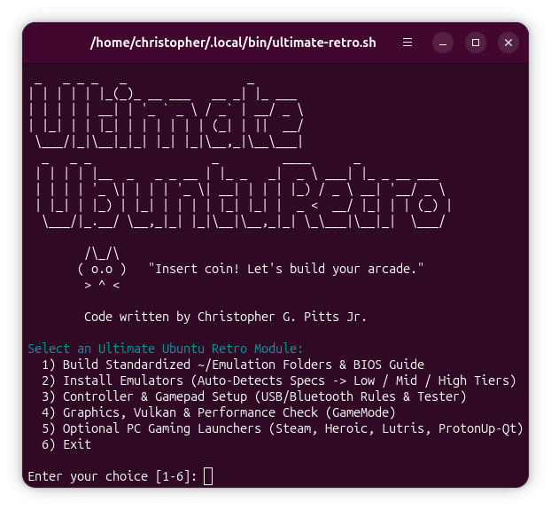

# Ultimate Ubuntu Retro

A hardware-aware emulation setup, standardized ROM/BIOS organizer, and controller configurator for Ubuntu 26.04+—part of **The Ultimate Ubuntu Suite**.



## Features
- **Hardware-Aware Tiered Installer:** Automatically detects your CPU cores, RAM, and GPU to recommend **Low Tier** (8-bit/16-bit via RetroArch), **Mid Tier** (adds DuckStation, PPSSPP, MelonDS), or **High Tier** (adds PCSX2 & Dolphin)—while letting you pick any tier or custom mix.
- **Standardized `~/Emulation` Tree:** Creates clean folders for `ROMs/` (16 classic systems), `BIOS/`, `Saves/`, and `Screenshots/`, complete with an included `README_BIOS.txt` cheat sheet and pre-configured Flatpak filesystem permissions.
- **USB & Bluetooth Controller Setup:** Installs `steam-devices` udev rules (PlayStation, Xbox, Switch Pro, 8BitDo), `jstest-gtk` visual calibration, and an optional Xbox Wireless Bluetooth ERTM fix.
- **Graphics & GameMode Check:** Installs `vulkan-tools` and Feral `gamemode`, verifying active Vulkan/GPU drivers.
- **Optional PC Gaming Launchers:** One-stop toggles to add **Steam**, **Heroic Games Launcher**, **Lutris**, or **ProtonUp-Qt**.

## Installation & Quick Start

### Option 1: Instant Run (No Download Needed)
Run directly in your terminal to set up your emulation rig:
```bash
bash <(wget -qO- [https://raw.githubusercontent.com/kintaris3/Ultimate-Ubuntu-Retro/main/ultimate-retro.sh](https://raw.githubusercontent.com/kintaris3/Ultimate-Ubuntu-Retro/main/ultimate-retro.sh))
```

### Option 2: Install as a Desktop App (`.deb`)
```bash
wget [https://github.com/kintaris3/Ultimate-Ubuntu-Retro/releases/download/v1.0/UURetro_v1.0.zip](https://github.com/kintaris3/Ultimate-Ubuntu-Retro/releases/download/v1.0/UURetro_v1.0.zip) && unzip UURetro_v1.0.zip && sudo apt install ./UURetro_v1.0/ultimate-ubuntu-retro_1.0_all.deb
```

### Option 3: Manual Download
1. Download `UURetro_v1.0.zip` from the [Releases](https://github.com/kintaris3/Ultimate-Ubuntu-Retro/releases) page.
2. Right-click `UURetro_v1.0.zip` and select **Extract Here**.
3. Open the `UURetro_v1.0` folder and double-click `ultimate-ubuntu-retro_1.0_all.deb` to install via App Center, or run `sudo apt install ./UURetro_v1.0/ultimate-ubuntu-retro_1.0_all.deb`.
4. Press the **Super** key and launch **Ultimate Ubuntu Retro**.

## The Complete Ultimate Ubuntu Suite
- [Ultimate Ubuntu Kickstart](https://github.com/kintaris3/Ultimate-Ubuntu-Kickstart) — Day-1 post-install setup & debloater
- [Ultimate Ubuntu Updater](https://github.com/kintaris3/Ultimate-Ubuntu-Updater) — One-click APT, Flatpak, & Snap maintenance
- [Ultimate Ubuntu Rescue](https://github.com/kintaris3/Ultimate-Ubuntu-Rescue) — System repair, space recovery, & hardware diagnostics
- [Ultimate Ubuntu Backup](https://github.com/kintaris3/Ultimate-Ubuntu-Backup) — System snapshots, personal backups, & migration cloning
- [Ultimate Ubuntu Retro](https://github.com/kintaris3/Ultimate-Ubuntu-Retro) — Hardware-aware emulation & controller configurator
- [Ultimate Ubuntu Revival](https://github.com/kintaris3/Ultimate-Ubuntu-Revival) — Thermal, ZRAM, Wi-Fi, & performance optimizer for older hardware

